# Cursorway

在 Mac 和 Windows 之間共用一組鍵盤滑鼠，並且雙向複製貼上文字、檔案和資料夾。

把滑鼠移到螢幕邊緣，就會跑到另一台電腦；在一台按複製，到另一台直接貼上。一台主控端可以接多台接收端。

**[下載最新版](https://github.com/sunnylinisme/Cursorway/releases/latest)**

| 系統 | 檔案 |
|---|---|
| Windows 10（1903 以上）／11，x64 | `Cursorway-Setup-X.Y.Z-x64.exe`（建議），或免安裝的 `Cursorway-X.Y.Z-x64-portable.zip` |
| Apple Silicon Mac，macOS 15 以上 | `Cursorway-X.Y.Z-macos-arm64.zip` |

## 功能

- **共用鍵盤滑鼠**：用「排列螢幕」拖拉決定每台電腦的位置，滑鼠碰到邊緣就切換過去。
- **雙向剪貼簿**：文字、多個檔案、整個資料夾都能複製貼上，大檔案也可以，傳送時會顯示進度。
- **自動找到電腦**：同一個區網內開著程式的電腦會自動出現，不用輸入 IP。
- **安全配對**：兩邊畫面會顯示相同的 6 位數配對碼，雙方都按同意才會配對；之後用保存的憑證自動重連，IP 改變也沒關係。
- **快捷鍵切換**：Control+Option（Windows 是 Ctrl+Alt）加號碼，直接跳到指定的電腦；號碼可以自己設定。
- **改設定不斷線**：調整排列或進階設定時，已連線的電腦不會斷線。
- **淺色／深色模式**：可以跟隨系統。
- 跨網段或 VPN 時，可以在進階設定填入對方的 IP 位址或電腦名稱。

## 跟原版 Barrier 有什麼不同

| | Barrier | **Cursorway** |
|---|---|---|
| 第一次連線 | 手動輸入主控端的 IP 或電腦名稱，再核對一長串憑證指紋 | **附近的電腦自動出現**，兩邊看到一樣的 6 位數配對碼，各按一次「同意」就連上 |
| 複製貼上 | 只有文字和圖片 | **檔案、多個檔案、整個資料夾都能雙向複製**，大檔案也行，會顯示傳送進度 |
| 改設定 | 套用時重新啟動，已連線的電腦會斷線 | **排列、進階設定改了就生效，不會斷線** |
| 介面 | 跨平台的 Qt 介面，設定項目多 | **Windows／Mac 原生介面**，淺色／深色模式，一個視窗看完狀態 |
| 快捷鍵切換 | 要自己寫設定 | **Ctrl+Alt（Mac 為 Control+Option）＋號碼**，號碼可以在介面上改 |
| 維護 | 2021 年後沒有新版 | 持續更新，程式內會提示新版 |

## 開始使用

1. **安裝**
   - Windows：執行安裝程式（需要按一次「是否允許」），裝好後從開始功能表開啟 Cursorway。
   - Mac：解壓縮後把 `Cursorway.app` 拖到「應用程式」再開啟。目前沒有經過 Apple 公證，若被阻擋，請到「系統設定 → 隱私權與安全性」允許開啟。第一次需要允許「區域網路」、「輔助使用」和「輸入監控」。
2. **選角色**：有實體鍵盤滑鼠的那台選「主控端」，其他電腦選「接收端」。
3. **配對**：主控端在「附近電腦」選接收端，按「邀請配對」。兩邊核對 6 位數配對碼相同後，各按「相同，同意」。
4. 配對完成後就會自動連線。之後只要兩台都開著程式就好。

完整說明、各版更新內容和限制，請看 [GUI-README.txt](tools/native-file-drop/GUI-README.txt)；技術細節見 [tools/native-file-drop/README.md](tools/native-file-drop/README.md)。

## 注意事項

- 兩台電腦要在同一個區網（或在進階設定填入對方位址）。
- Windows 的免安裝版沒有背景服務，所以在登入畫面、UAC 畫面和以系統管理員身分執行的視窗上，接收端的滑鼠鍵盤可能無法操作；請用安裝版。
- 檔案要整批接收完才能貼上，沒有續傳。

## 來源與授權

Cursorway（原名 Barrier Share）是以 [Barrier](https://github.com/debauchee/barrier) 為基礎修改而成，沿用 Barrier 的鍵盤滑鼠核心，另外加上 Mac／Windows 原生視窗程式、區網搜尋配對和檔案剪貼簿。

依原專案授權，以 [GPL-2.0](LICENSE) 發布。
